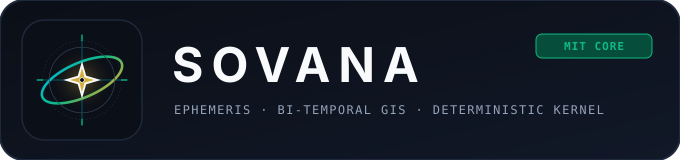

<p align="center">
  
</p>

<p align="center">
  <strong>Zero-Dependency Astronomical Ephemeris (NASA JPL DE440s), Bi-Temporal Vietnam GIS (63↔34), Multi-System Symbolic Kernel, MCP Server &amp; Cross-Harness Agent Plugin</strong><br/>
  <a href="https://github.com/nguyenthanhthe/sovana/actions/workflows/ci.yml"></a>
  <a href="./LICENSE"></a>
  
  
  
  
</p>

<p align="center">
  <strong>Live Reference App:</strong> <a href="https://vanmenh-tuvi.vercel.app">vanmenh-tuvi.vercel.app</a> ·
  <strong>Interactive Engine Inspector:</strong> <code>examples/xray-inspector</code> ·
  <strong>License:</strong> Clean-Room MIT
</p>

---

## Why SOVANA?

LLMs cannot reliably compute lunisolar dates, solar terms, historical timezones, or star placements — and most existing East Asian calendar libraries hardcode `UTC+8` (Beijing) or flat `GMT+7`, silently breaking Vietnamese historical and astronomical edge cases:

| Real-World Edge Case | Typical Calendar / Horoscope Library | SOVANA (`@sovana/*` · `sovana`) |
|---|---|---|
| **Pre-1975 South Vietnam births** (`1960–1975` RVN `UTC+8` vs DRV `UTC+7`, `1945 UTC+9`) | Hardcodes `UTC+7` → shifts night births by 1 shichen (wrong Mệnh palace) | Statutory historical timezone regime resolver split along the 17th parallel |
| **VN `UTC+7` (`Quyết định 121-CP`) vs CN `UTC+8` lunar divergences** (`1968`, `1985`, `2007`, `2030`) | Treats Beijing lunar calendar as Vietnam lunar calendar | Dual-calendar NASA JPL **`DE440s`** ephemeris (`58.9 KB` binary, `1900–2100`), automatically flags divergences |
| **Vietnam 2025 Administrative Merger** (`Nghị quyết 202/2025/QH15`: `63 → 34` provinces) | Unmapped or stale province list | Bidirectional GIS: **63 legacy provinces (~705 districts) ↔ 34 post-2025 provinces** + historical aliases (`Sài Gòn`, `Gia Định`, `Hà Tây`) |
| **True Solar Time & Geodesics** | Uses civil clock time directly | Meeus Equation of Time + longitude meridian offset + WGS-84 Vincenty geodesic azimuth |
| **Cross-School Integrity** | Mixes Vietnamese *Nam Phái* and *Toàn Thư* rules silently | Compiles isolated `nam-phai` (109 stars) & `toan-thu` charts side-by-side with explicit `empiricalForks` |
| **AI Agents & Hallucination Control** | Prompts ask LLM to calculate dates/stars | First-class zero-dependency **MCP server (`npx -y @sovana/mcp`)**, **5 Thầy Số Agent Skills**, **5 Slash Commands**, **2 Specialist Subagents** & RFC 8785 SHA-256 digests |

---

## Quickstart 1: Cross-Harness Agent Plugin + `npx -y @sovana/mcp`

SOVANA ships as a **Cross-Harness Agent Plugin** — one canonical source of **Skills**, **Slash Commands**, **Specialist Subagents**, **Operating Rules**, and **MCP Tools** (`npx -y @sovana/mcp`) with native manifests for every major AI coding harness:

| Harness | Install / Connect Command | Native Manifest |
|---|---|---|
| **Claude Code** | `/plugin marketplace add nguyenthanhthe/sovana` then `/plugin install sovana` | `.claude-plugin/marketplace.json`, `.claude-plugin/plugin.json`, `.mcp.json` |
| **Any Agent (`skills.sh`)** | `npx skills add nguyenthanhthe/sovana` | `skills/*/SKILL.md` |
| **Gemini CLI** | `gemini extensions install https://github.com/nguyenthanhthe/sovana` | `gemini-extension.json`, `GEMINI.md` |
| **Antigravity** | Install plugin from repository URL or configure `mcp_config.json` | `plugin.json`, `mcp_config.json`, `rules/AGENTS.md` |
| **Cursor** | Install plugin from `.cursor-plugin/plugin.json` or use `.mcp.json` | `.cursor-plugin/plugin.json`, `.mcp.json` |
| **OpenCode** | Clone/open repo (auto-loads `opencode.json` + `AGENTS.md`) | `opencode.json`, `AGENTS.md` |
| **OpenAI Codex** | Reads `AGENTS.md` + `skills/` natively; add 3-line `[mcp_servers.sovana]` block below | `AGENTS.md`, `skills/*/SKILL.md` |

### Standalone MCP Config (`npx -y @sovana/mcp`)

<details open>
<summary><strong>Claude Desktop / Cursor / Windsurf / Antigravity (JSON)</strong></summary>

```json
{
  "mcpServers": {
    "sovana": {
      "command": "npx",
      "args": ["-y", "@sovana/mcp"]
    }
  }
}
```
</details>

<details>
<summary><strong>Claude Code CLI &amp; OpenAI Codex CLI</strong></summary>

```bash
# Claude Code
claude mcp add sovana -- npx -y @sovana/mcp
```

```toml
# OpenAI Codex (~/.codex/config.toml)
[mcp_servers.sovana]
command = "npx"
args = ["-y", "@sovana/mcp"]
```
</details>

<details>
<summary><strong>Run From Local Source (Without npm Registry)</strong></summary>

```bash
git clone https://github.com/nguyenthanhthe/sovana.git
cd sovana
pnpm install && pnpm build
node packages/mcp/dist/cli.js --version
```

Point your MCP client `command` to `node` and `args` to `["/absolute/path/to/sovana/packages/mcp/dist/cli.js"]`.
</details>

### Bundled Agent Capabilities

| Layer | Included Components |
|---|---|
| **5 Specialist Skills (`skills/`)** | `thay-tu-vi` (Nam Phái 109 stars & Toàn Thư) · `thay-dinh-gio` (Blind Birth-Hour Rectification) · `thay-bat-tu` (Four Pillars & *Cùng Thông Bảo Giám* Điều Hậu) · `thay-gieo-que` (64-hexagram Chu Dịch & Lục Hào) · `thay-hop-ban` (2-chart Synastry for Marriage & Co-Founders) |
| **5 Slash Commands (`commands/`)** | `/tu-vi` · `/dinh-gio` · `/bat-tu` · `/gieo-que` · `/hop-ban` |
| **2 Specialist Subagents (`agents/`)** | `sovana-diviner` (multi-system chart reading) · `sovana-rectifier` (ambiguous shichen & pre-1975 timezone rectification) |
| **6 Deterministic MCP Tools (`@sovana/mcp`)** | `resolve_vietnam_location` · `convert_vietnam_calendar` · `compile_ziwei_chart` · `compile_bazi_chart` · `cast_iching_hexagram` · `compare_charts_hopban` |

See [`packages/mcp/README.md`](./packages/mcp/README.md) for full tool schemas and protocol details.

---

## Monorepo Packages

| Package | Runtime | Gzipped Size | Purpose |
|---|---|---:|---|
| [`@sovana/geo-time`](./packages/geo-time) | Node.js & Browser | `16.8 KB` | NASA JPL DE440s ephemeris (`1900–2100`), VN/CN lunisolar converter, bi-temporal `63↔34` Vietnam GIS, historical timezones, Meeus True Solar Time, WGS-84 Vincenty |
| [`@sovana/kernel`](./packages/kernel) | Node.js & Browser | `23.0 KB` | Immutable `ChartIR` compiler: Tử Vi (`nam-phai` 109 stars + `toan-thu`), multi-layer Tứ Hóa, structured patterns, quantitative Bát Tự (*Cùng Thông Bảo Giám*), 64-hexagram Chu Dịch |
| [`@sovana/solver`](./packages/solver) | Node.js & Browser | `25.3 KB` | Stratified forward-chaining DAG rule solver (Church-Rosser confluent), paraconsistent conflict tracking, Shannon-entropy Bayesian birth-hour rectifier, and 2-chart Hợp Bàn synastry |
| [`@sovana/mcp`](./packages/mcp) | Node.js (`>=22`) | Zero deps | Model Context Protocol (`2025-03-26` / `2024-11-05`) stdio JSON-RPC 2.0 server (`npx -y @sovana/mcp`) exposing 6 deterministic tools |
| [`sovana`](./python/sovana) | Python `>=3.11` | Pure Python + Pydantic | Bit-exact Python mirror verified against TypeScript via RFC 8785 Canonical JSON SHA-256 lockstep |
| [`examples/xray-inspector`](./examples/xray-inspector) | Browser | Self-contained HTML | Standalone visual X-Ray inspector for 12-palace charts, DAG provenance graphs, and astronomical telemetry |

---

## Quickstart 2: TypeScript (`@sovana/*`)

```ts
import { normalizeBirthTemporal, resolveLocation } from '@sovana/geo-time';
import { compileChartIR, detectStructuredPatterns } from '@sovana/kernel';
import { evaluateHopBan } from '@sovana/solver';

// 1. Bi-temporal Vietnam GIS (63 <-> 34 merger under Nghị quyết 202/2025/QH15)
const loc = resolveLocation('Sài Gòn');
console.log(loc.canonicalName, loc.post2025Id, loc.tzZone);
// -> Thành phố Hồ Chí Minh, tp-ho-chi-minh, VN_SOUTH_RVN

// 2. Historical pre-1975 timezone (South Vietnam UTC+8) + Meeus True Solar Time
const temporal = normalizeBirthTemporal({
  year: 1968,
  month: 5,
  day: 15,
  hour: 1,
  minute: 15,
  location: 'Sài Gòn',
  calendarMode: 'VN_HISTORICAL',
});
console.log(temporal.timezone.utcOffsetLabel, temporal.trueSolarTime.formattedTime);
// -> +08:00, 00:25:xx (exact True Solar Time via DE440s + Meeus EoT)

// 3. Compile both Nam Phái (109 stars) & Toàn Thư charts + Bazi + Structured Patterns
const chart = compileChartIR({ temporal, gender: 'male', targetYear: 2026 });
const patterns = detectStructuredPatterns(chart.ziweiNamPhai);
console.log(chart.ziweiNamPhai.cucNameVi, chart.empiricalForks.consensusMode, patterns.length);
```

---

## Quickstart 3: Python (`sovana`)

```python
from sovana.geo_time import normalize_birth_temporal, resolve_location, sha256_canonical
from sovana.kernel import compile_chart_ir

loc = resolve_location("Huế")
temporal = normalize_birth_temporal(
    year=1985,
    month=4,
    day=16,
    hour=10,
    minute=0,
    location="Huế",
    calendar_mode="VN_UTC7",
)

# Detects VN UTC+7 vs CN UTC+8 1985 leap-month divergence automatically
chart = compile_chart_ir(temporal=temporal, gender="female", target_year=2026)
print(chart.empirical_forks.is_lunar_divergent_vn_cn)  # True
print(sha256_canonical(temporal))  # Bit-exact match with TypeScript @sovana/geo-time
```

---

## Comparison with Prior Art

SOVANA builds respectfully on ideas from open-source pioneers (`iztro`, `lunar-typescript`, `lasotuvi`, `astronomy-engine`) while focusing specifically on **astronomical determinism, Vietnam historical regimes, polyglot lockstep, and cross-harness AI agent tooling**:

| Capability | `lasotuvi` (Py) | `iztro` (TS) | `lunar-typescript` | **SOVANA (TS + Py + MCP + Plugin)** |
|---|:---:|:---:|:---:|:---:|
| NASA JPL `DE440s` binary ephemeris (`1900–2100`) | — | — | — | **Yes (`58.9 KB`)** |
| Pre-1975 Vietnam North/South historical timezones | — | — | — | **Yes** |
| VN `UTC+7` (`121-CP`) vs CN `UTC+8` divergence tracking | — | — | — | **Yes (`146,828` round-trip checks)** |
| Vietnam `63 ↔ 34` province GIS (`202/2025/QH15`) | — | — | — | **Yes (~705 districts + aliases)** |
| Dual-school Zi Wei (`Nam Phái` 109 stars + `Toàn Thư`) | Nam Phái | Toàn Thư | — | **Both side-by-side** |
| Quantitative Bazi (*Cùng Thông Bảo Giám*) + 64-hex I-Ching | — | — | Bazi | **Both + Köppen climate audit** |
| Bayesian Blind Birth-Hour Rectification + DAG Solver | — | — | — | **Yes (Church-Rosser confluent)** |
| Bit-Exact TypeScript ↔ Python SHA-256 Lockstep | — | — | — | **Yes (RFC 8785 JCS)** |
| Zero-Dependency MCP Server (`npx -y @sovana/mcp`) | — | — | — | **Yes (`6` tools)** |
| Cross-Harness Agent Plugin (Claude / Antigravity / Codex / OpenCode / Cursor) | — | — | — | **Yes (`5` skills, `5` commands, `2` agents)** |

---

## Verified Benchmarks & Lockstep Proofs

Every commit is verified in GitHub Actions across **Ubuntu + Windows** (`pnpm verify:lockstep`):

| Verification Suite | Scope | Mismatches | Measured Speed |
|---|---|---:|---|
| Full Civil-Day Solar ↔ Lunar Sweep (`1900–2100`) | `73,414` days (`146,828` VN + CN checks) | **`0`** | TS `1.97 s` · Py `21.6 s` |
| Adversarial Geo-Time Lockstep (`TS ↔ Py`) | `10,000` edge-case vectors | **`0`** | TS **`0.227 ms/op`** · Py `0.727 ms/op` |
| Full-Stack Lockstep (`geo-time` + `kernel` + `solver`) | `1,200` full charts + DAG proofs | **`0`** | TS `3.35 ms/vec` · Py `13.64 ms/vec` |
| Algebraic `Z12` Invariants & Kernel Throughput | `10,000` trials / `2,000` bench ops | **`0`** | **`0.0326 ms/chart`** (~30,600 charts/sec) |
| Church-Rosser Rule-Order Confluence | `100` random permutations | **`0`** | Identical RFC 8785 SHA-256 across all orders |
| Cross-Harness Plugin & Standalone Packed `npx` Smoke | `8` manifests + `4` packed `.tgz` tarballs | **`0`** | All `6` MCP tools verified offline outside monorepo |

---

## Reference Production Application

Want to see SOVANA running in production?

- **[Vận Mệnh — Tĩnh Thất Quan Tượng (`vanmenh-tuvi.vercel.app`)](https://vanmenh-tuvi.vercel.app)** — Live interactive 3D Zi Wei Dou Shu, Four Pillars, Chu Dịch & Blind Birth-Hour Rectification web application powered by `@sovana/geo-time`, `@sovana/kernel`, and `@sovana/solver`.

---

## Local Verification

```bash
# TypeScript workspace (Node >= 22, pnpm 10)
pnpm install
pnpm build
pnpm typecheck
pnpm test
pnpm validate:plugin
pnpm verify:packed

# Python workspace (Python >= 3.11, uv)
uv sync --all-packages
uv run ruff check
uv run mypy python/sovana/src
uv run pytest

# Cross-runtime RFC 8785 Canonical JSON SHA-256 lockstep
pnpm verify:lockstep
```

---

## License & Provenance

Released under the **[MIT License](./LICENSE)**. All mathematical derivations, binary ephemeris tables, and GIS attributions are documented in **[CREDITS.md](./CREDITS.md)** (strict clean-room MIT; zero `CC BY-NC-SA` contamination).
